# FruitCount 🍅 — Tomato Detection, Ripeness Staging & Visible-Fruit Counting

**Day 33 / 100 Days of Projects** · [English documentation](docs/en/README.md) · [Dokumentasi Bahasa Indonesia](docs/id/README.md) · [GitHub](https://github.com/MENSTRUE/FruitCount)

> **Status (repository audit: 7 November 2026):** YOLO11n V4 checkpoint was trained and exported; FastAPI inference and React UI are implemented; local screenshots and unit tests are present. Independent end-to-end validation, V4 counting error and V4 held-out test metrics remain **not yet verified**. This is a research/prototype application, not a validated yield-estimation service.

## Executive summary / Ringkasan

FruitCount uses a **fine-tuned YOLO11n detector** to return tomato bounding boxes, six visible ripeness classes, per-class counts and total *detected visible* fruits from a single image. **Indonesia:** FruitCount memproses satu foto untuk mendeteksi dan menghitung tomat yang terlihat, bukan menghitung seluruh panen atau menjamin tingkat kematangan sebenarnya.

### Problem, users and scope

Manual inspection of tomato clusters is repetitive and subjective. Intended users: students, researchers, agronomists and growers testing an assisted visual screening workflow. This MVP supports **image-based object detection, stage assignment and counting of detections**; it does **not** provide a calibrated ripeness diagnosis, fruit weight, biomass, total plant yield, realtime tracking or automated farm decisions.

| Feature | Audited state | Evidence |
|---|---|---|
| Six-stage detection | Implemented in backend | `backend/app/services/detector.py` |
| Image upload, boxes and class counts | Implemented | `backend/app/api/routes.py`, `frontend/src/App.tsx` |
| Validation-trained checkpoint | Manifest exists; local weight ignored in Git | `reports/trained_model_manifest.json` |
| V4 validation history | Available | `reports/train_results.csv`, training plots |
| V4 counting MAE/RMSE | **Not yet evaluated** | Separate phase required |
| Independent blind test | **Not available** | Test split previously inspected in V2/V3 |
| Public deployment / production readiness | **Not verified** | Run locally; secure before deployment |

## Before → Now → Next

- **Before:** scratch detector V2 was insufficient; V3 Save Version mixed training with long post-training evaluation and did not reliably deliver a final archive.
- **Now:** V4 trains and exports the checkpoint first. UI and FastAPI API are in the repository; there are real training reports, class metrics at the validation-history epoch, and a local screenshot.
- **Next:** reproduce `/ready` + sample inference, measure image-level counting errors on frozen thresholds, evaluate domain shift, audit the original source/license, and publish a reproducible demo.

## Data and provenance

**AerialYield-T2M** (dataset [Kaggle mirror](https://www.kaggle.com/datasets/wafabila/fruitcount-dataset); provenance in [`reports/source_provenance.json`](reports/source_provenance.json) and [`docs/en/dataset_provenance.md`](docs/en/dataset_provenance.md)). The bundled source README reports **677 RGB images: 535 close-range and 142 drone**, split 477/105/95. Across splits: **14,190 COCO geometry-filtered boxes** vs **14,303 raw visible fruits** (from image-level manifest). The raw count target is not interchangeable with detection box count.

| Official split | Images | COCO boxes |
|---|---:|---:|
| Train | 477 | 10,050 |
| Validation | 105 | 1,938 |
| Test | 95 | 2,202 |

Classes (checkpoint ID order): `Green`, `Breakers`, `Turning`, `Pink`, `Light Red`, `Red`. The release metadata reports **CC BY 4.0** for source data; attribution to original authors/manuscript must be checked before reuse. Source release code: [Tomato_dataset](https://github.com/afeefaaazam03/Tomato_dataset). Images are not committed to this repository.

The **V4** audit reports no decode/dimension failures and no shared filename-derived block groups, but **full exact SHA-256 re-audit was disabled**, and no perceptual duplicate or plant-level independence check was completed. This is not proof of zero data leakage; acquisition sessions are not held out.

## Experiment and model

The final reproducible training config in [`reports/experiment_config.json`](reports/experiment_config.json): pretrained YOLO11n, **960 px**, batch **4**, **60 epochs**, patience **12**, seed **42**, workers **0**, Ultralytics **8.4.203**, PyTorch **2.11.0+cu130**. Ultralytics selected `best.pt` using **validation fitness**, with manifest identifying **epoch 48** as the selected checkpoint in prior execution logs. The tracked CSV at epoch 48 reports:

| Epoch-48 validation-history metric | Value |
|---|---:|
| Precision (B) | 0.49079 |
| Recall (B) | 0.54330 |
| mAP@50 (B) | 0.47902 |
| mAP@50:95 (B) | 0.37599 |

**These are validation-history figures at epoch 48, not test metrics.** For current details see [Evaluation](docs/en/evaluation.md), [Experiments](docs/en/experiments.md), and [`train_results.csv`](reports/train_results.csv). V4's ZIP/manifest includes SHA-256 for the selected checkpoint: `af3339a3593d6b273fd4be0c6e479ed4f83d701c27426de9605e3438ebccd0e8` (5,524,122 bytes). The binary `models/best.pt` is intentionally ignored by Git and must be provisioned locally. **Do not publish a model download link without verifying distribution rights.**

## System architecture

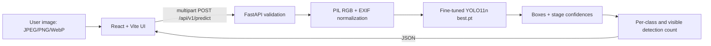

- [API contract](docs/en/architecture.md) and [integration instructions](docs/integration.md).
- `/api/v1/health`: reports checkpoint **file presence**, not full loadability.
- `/api/v1/ready`: attempts loading and checking the six-class checkpoint.
- `/api/v1/predict`: upload `image`, query `confidence` 0.05–0.95 (default 0.25) and `iou` 0.1–0.95 (default 0.65). Response includes original-image pixel `xyxy`, class ID/name, confidence, total count, class counts, inference elapsed ms and warnings.
- Frontend displays loading/error states, draggable upload, overlay, class filter, chart, and JSON export; it does not fabricate inference.

## Getting started (Windows PowerShell)

Run from the **repository root**. Use a fine-tuned V4 checkpoint, **not** the original pretrained `yolo11n.pt`:

```powershell
cd 'D:\porto\100 day\day 33\FruitCount'
python -m venv .venv
.\.venv\Scripts\Activate.ps1
python -m pip install -r backend/requirements.txt
$env:PYTHONPATH = (Resolve-Path '.\backend').Path
python -m pytest backend/tests -q
python -m uvicorn app.main:app --reload --host 127.0.0.1 --port 8000
```

In a **second terminal**:

```powershell
cd 'D:\porto\100 day\day 33\FruitCount\frontend'
npm ci
npm run build
npm run dev
```

Open `http://127.0.0.1:5173` (web), `http://127.0.0.1:8000/docs` (API). Place `best.pt` at the **ignored** root `models/best.pt`; check `GET /api/v1/ready`, and perform an actual inference on a legitimate image. `npm run build` and pytest are verification commands to run locally, not results claimed by this document.

### Minimal API example

```powershell
curl.exe -X POST 'http://127.0.0.1:8000/api/v1/predict?confidence=0.25&iou=0.65' -F 'image=@sample.jpg'
```

**Privacy/security:** Allowed JPEG/PNG/WebP MIME types, 12 MiB upload cap and dimension checks; server processes in memory (no intentional upload persistence). Uploaded data can still be sensitive; no authentication/rate limit is implemented. Do not expose this development server to the public Internet without further protections.

## Visual evidence gallery — repository files

The assets below are **real files in `main`** as of the audit. Graphs describe training/validation, not final field performance.

### Dataset distribution

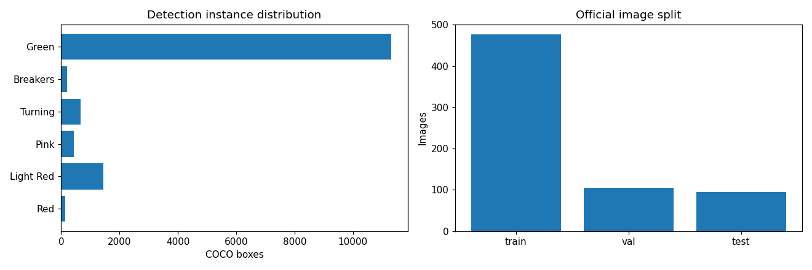

*Class distribution overview, not a leakage audit.*

### Training history

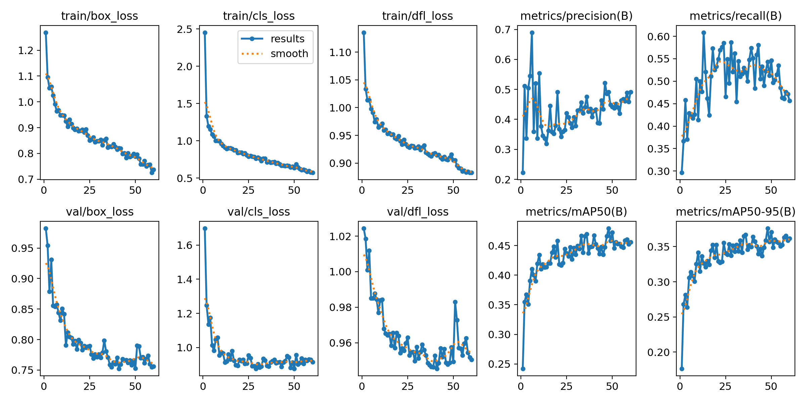

*Epoch-wise training and validation curves; see CSV for exact values.*

### Ground-truth label summary

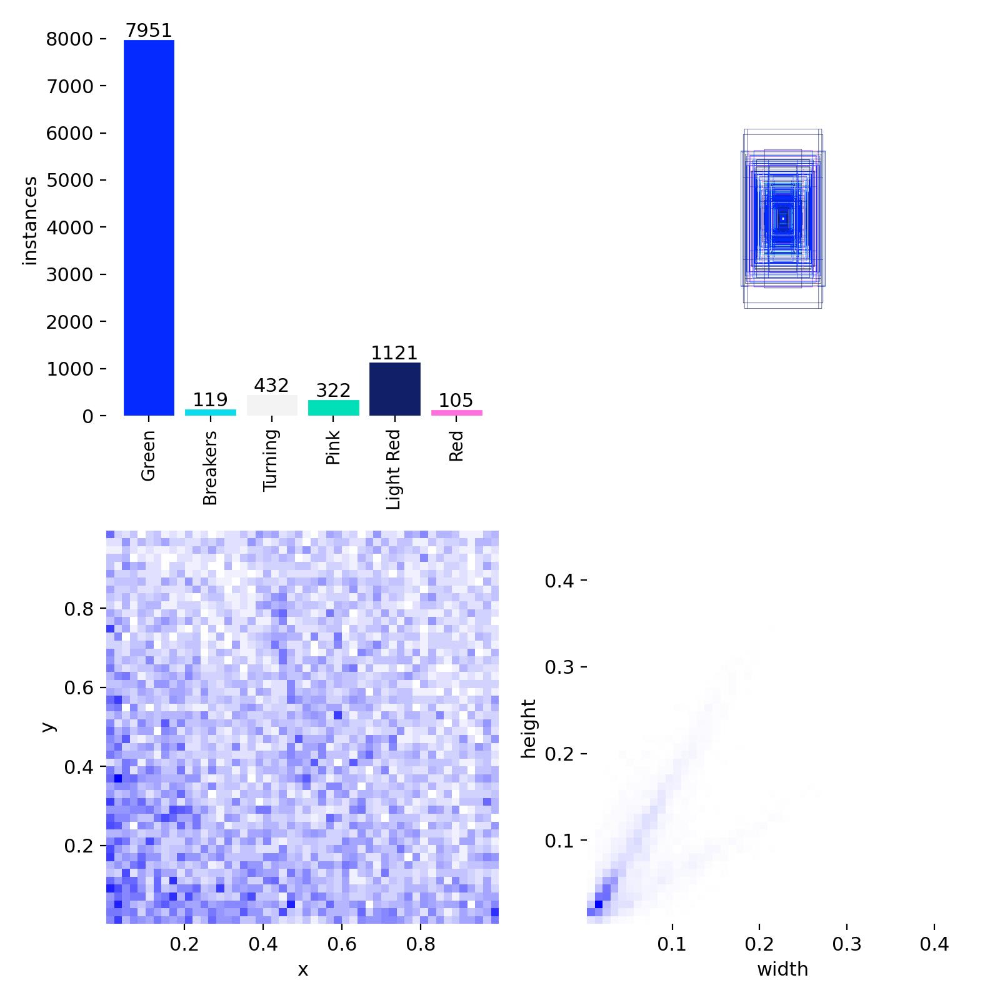

*Bounding-box and label-frequency overview.*

### Precision–recall

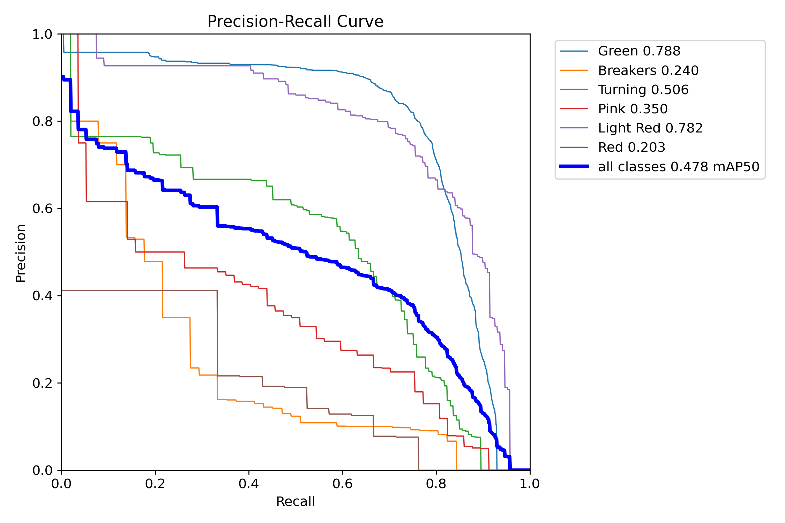

*Per-class precision–recall trade-offs on validation.*

### F1 vs confidence

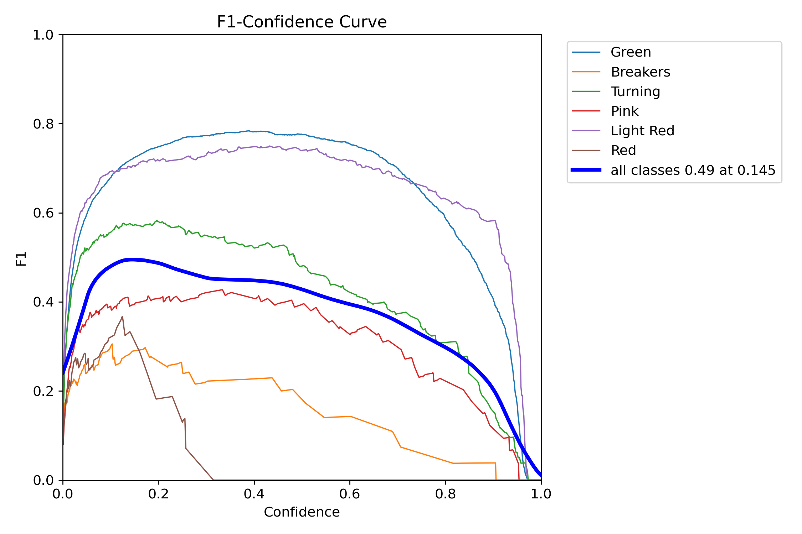

*Validation confidence/F1 relationship; threshold not calibrated.*

### Precision vs confidence

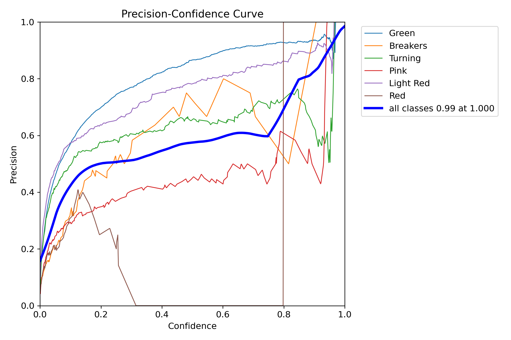

*Validation precision as the confidence threshold varies.*

### Recall vs confidence

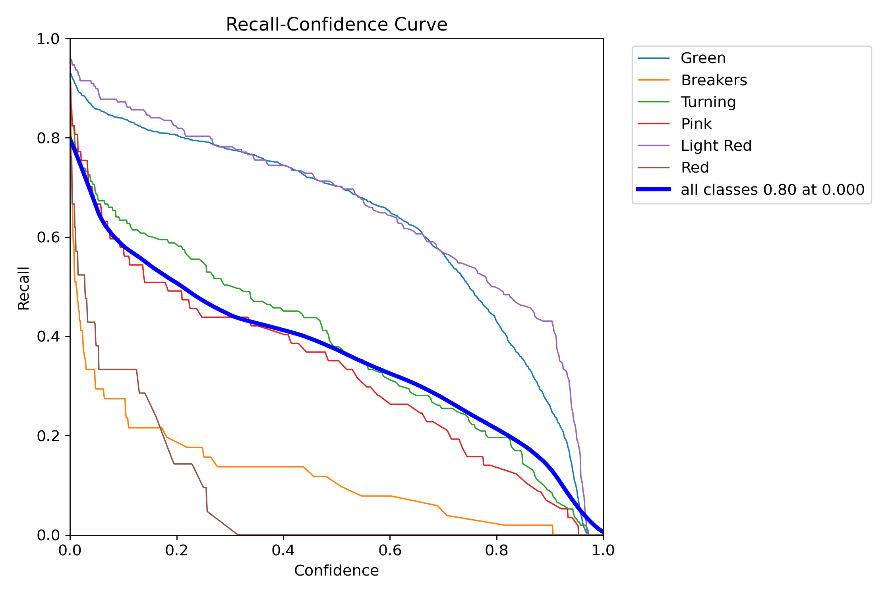

*Validation recall as the confidence threshold varies.*

### Confusion matrix

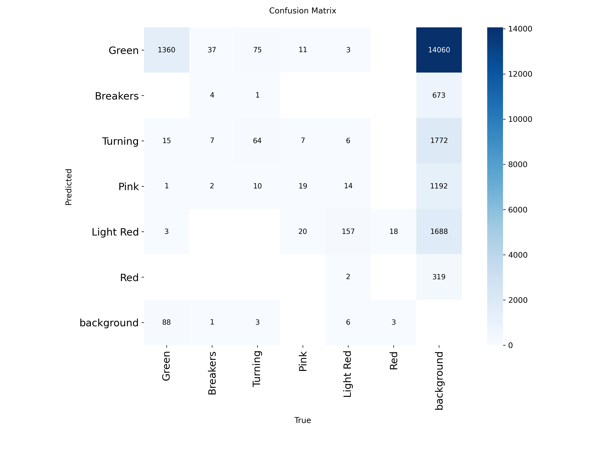

*Detection-class confusion, including missed/background assignments.*

### Normalized confusion matrix

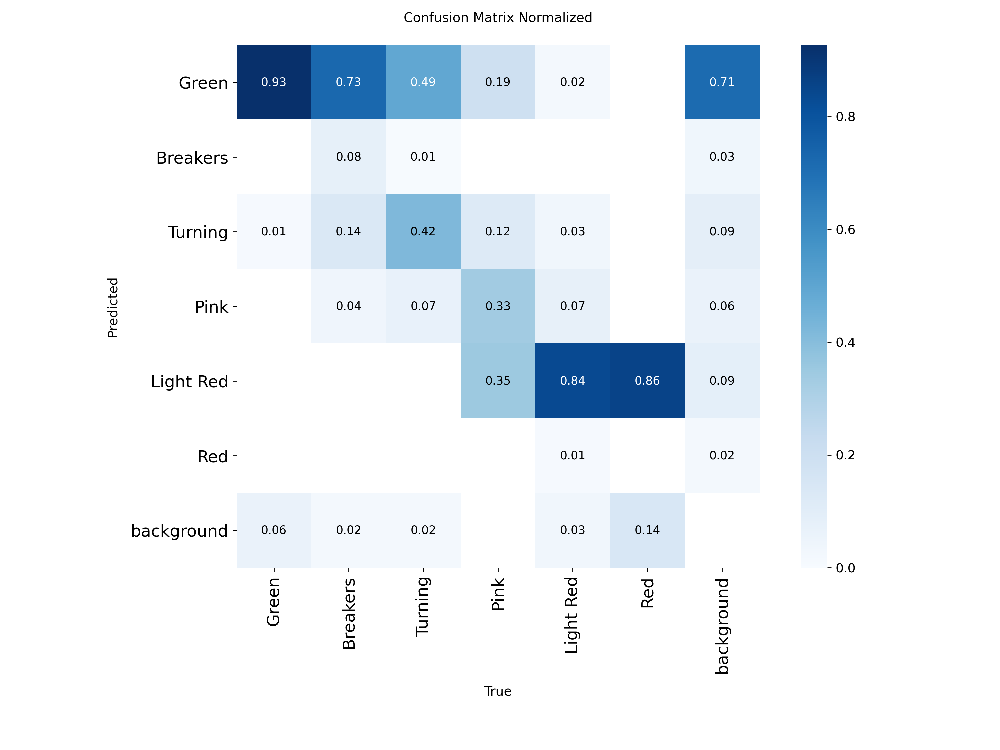

*Class-normalized comparison; interpret with class imbalance.*

### Ground-truth examples

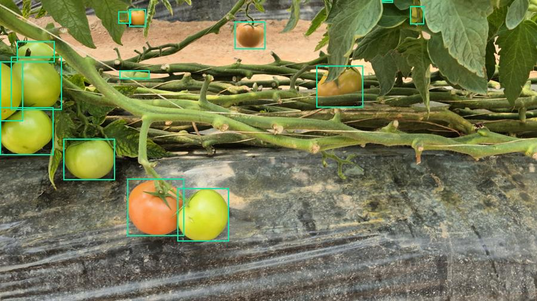

*Training image with ground-truth annotations; not a model prediction.*

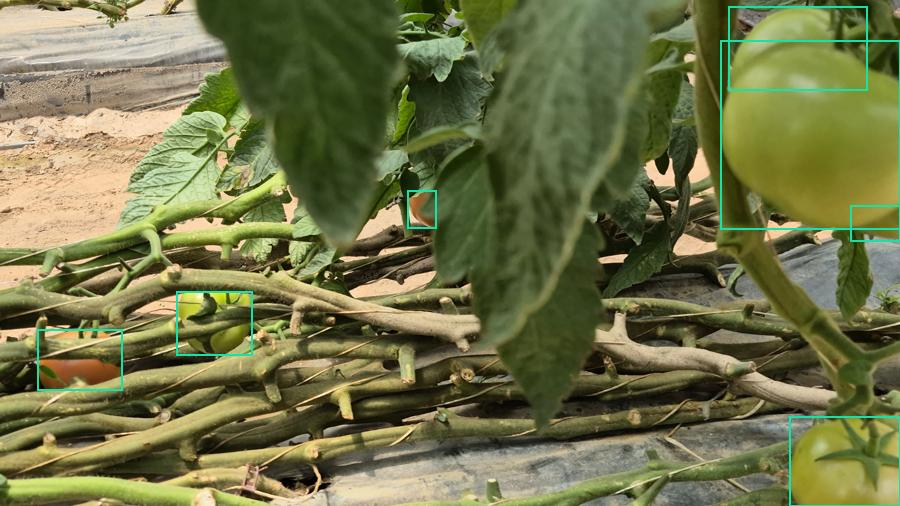

*Validation image with annotated instances; not a test result.*

### Local application screenshot


*Captured local frontend; a screenshot does not alone establish model accuracy or deployment.*

## Known limitations and scientific claims

Class imbalance, occlusion, small/distant fruit, lighting and close-range–drone domain shift affect results. The count equals the number of **predicted boxes** at a selected confidence threshold. Confidence is not calibrated probability; counting can be truncated by `max_det=500` in the API. V4 did not evaluate counting MAE/RMSE or final independent test. Local CPU speed and robustness are not benchmarked by available reports. The 95-image official test was examined earlier in development, so it is **not** a new blind benchmark.

## Repository map and documentation

- `backend/`: FastAPI implementation and dependency-overridden unit tests ([README](backend/README.md))
- `frontend/`: React/TypeScript/Vite dashboard ([README](frontend/README.md))
- `notebooks/fruitcount.ipynb`: V4 training/export workflow ([guide](notebooks/README.md))
- `models/`: ignored V4 `best.pt` locally; public metadata ([guide](models/README.md))
- `reports/`: audit JSON, dataset provenance, YAML/CSV, manifests ([guide](reports/README.md))
- `assets/`: real training plots, ground-truth examples and frontend screenshot ([inventory](assets/README.md))
- `docs/en/` and `docs/id/`: parallel full documentation ([index](docs/README.md))
- `scripts/`: documentation/utility folder ([README](scripts/README.md))

## Deployment, roadmap, license and references

Deployment is **not verified**. Before production: pin/test dependencies, secure upload endpoints, set CORS for deployment origin, add authentication/rate limiting, confirm performance and source/Ultralytics license obligations, and instrument inference errors. [Roadmap](docs/roadmap.md) · [Troubleshooting](docs/en/troubleshooting.md) · [Reproducibility](docs/en/reproducibility.md).

Project software terms: [`LICENSE`](LICENSE). The **dataset** states CC BY 4.0 in its bundled source; the **pretrained/fine-tuned model ecosystem** may have separate requirements. Do not conflate them. Source: [`reports/source_README.md`](reports/source_README.md). Check original authors and manuscript citation when preparing academic/public release.
