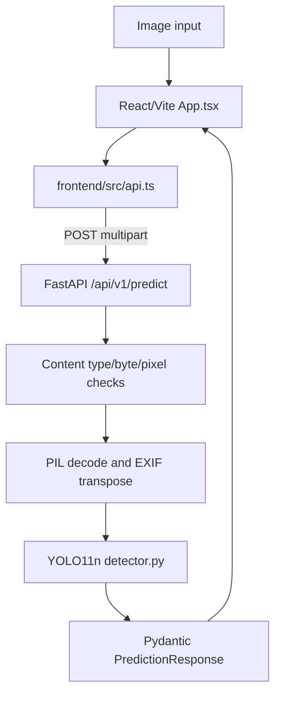

# System architecture and API

## Runtime components
`backend/app/main.py` constructs FastAPI and restricts CORS origins to localhost defaults. `backend/app/core/config.py` resolves ignored `models/best.pt` from repo root. `backend/app/services/detector.py` loads YOLO once per process via `lru_cache`, verifies exact 6-class names, and uses a lock around inference. `routes.py` applies image type/size/dimension limits and returns errors. `frontend/src/App.tsx` manages file preview, drag/drop, threshold, class filter, overlay, export JSON, loading/errors. `frontend/src/api.ts` does real `fetch` requests.

## Endpoint contract
| Method/URI | Input | Output/meaning |
|---|---|---|
| GET `/api/v1/health` | none | `status` + *file-presence* `model_ready` (not load success) |
| GET `/api/v1/ready` | none | Attempts load/validate checkpoint; 503 if unavailable |
| POST `/api/v1/predict` | multipart `image`, `confidence` 0.05–0.95, `iou` 0.1–0.95 | `model_name`, `image_width`, `image_height`, `total_count`, `counts`, `detections`, `inference_ms`, `warnings` |

Detection object has `class_id`, `class_name`, `confidence`, `box:[x1,y1,x2,y2]` (original-image pixel coordinates). HTTP 415 unsupported type, 413 upload/pixel limit, 400 invalid image, 503 missing/inference model failure. Image cap default 12 MiB; pixels max 35 million. The API has no authentication, quota enforcement or persistence system. Do not deploy publicly without hardening.

**Evidence baseline (2026-11-07):** `reports/dataset_audit.json`, `reports/source_provenance.json`, `reports/experiment_config.json`, `reports/trained_model_manifest.json`, `reports/train_results.csv`, and source implementation in `backend/app/` and `frontend/src/`. This material is a repository audit, not a new experiment.
