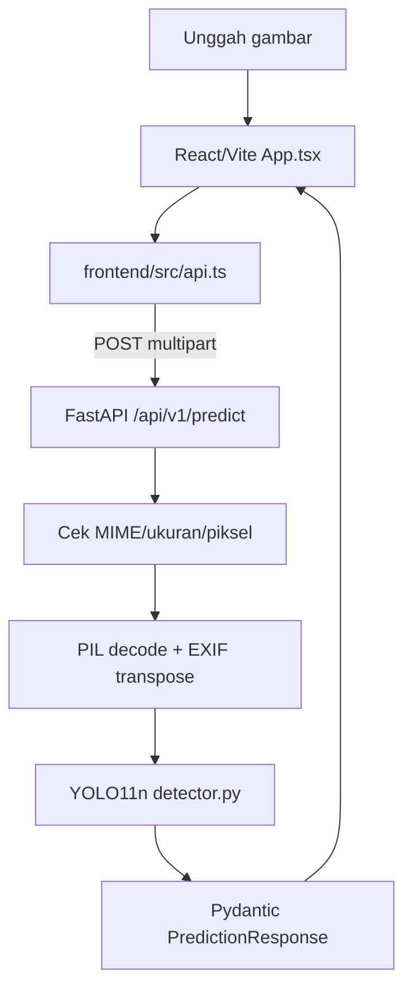

# Arsitektur sistem dan API

## Komponen runtime
`backend/app/main.py` membuat FastAPI dan membatasi CORS ke localhost secara default. `backend/app/core/config.py` menyelesaikan path `models/best.pt` dari root repo. `backend/app/services/detector.py` memuat YOLO sekali per proses via `lru_cache`, memvalidasi enam nama kelas, serta menggunakan lock saat inference. `routes.py` membatasi tipe/ukuran/dimensi gambar dan error HTTP. `frontend/src/App.tsx` mengelola preview, drag/drop, threshold, filter kelas, overlay, ekspor JSON, status/error. `frontend/src/api.ts` menggunakan request `fetch` nyata.

## Kontrak endpoint
| Method/URI | Input | Output/makna |
|---|---|---|
| GET `/api/v1/health` | tanpa input | `status` + `model_ready` yang hanya mengecek *keberadaan file*, bukan load model |
| GET `/api/v1/ready` | tanpa input | Mencoba memuat/memeriksa checkpoint; 503 jika gagal |
| POST `/api/v1/predict` | multipart `image`, `confidence` 0.05–0.95, `iou` 0.1–0.95 | `model_name`, `image_width`, `image_height`, `total_count`, `counts`, `detections`, `inference_ms`, `warnings` |

Setiap deteksi memuat `class_id`, `class_name`, `confidence`, `box:[x1,y1,x2,y2]` pada piksel gambar asli. HTTP 415 format salah, 413 file/piksel terlalu besar, 400 gambar rusak, 503 model/inference gagal. Batas default file 12 MiB dan piksel 35 juta. API belum mempunyai autentikasi, pembatasan trafik, atau penyimpanan permanen. Jangan deploy publik tanpa pengamanan.

**Dasar bukti (07-11-2026):** `reports/dataset_audit.json`, `reports/source_provenance.json`, `reports/experiment_config.json`, `reports/trained_model_manifest.json`, `reports/train_results.csv`, serta implementasi `backend/app/` dan `frontend/src/`. Dokumen ini hasil audit repository, bukan eksperimen baru.
